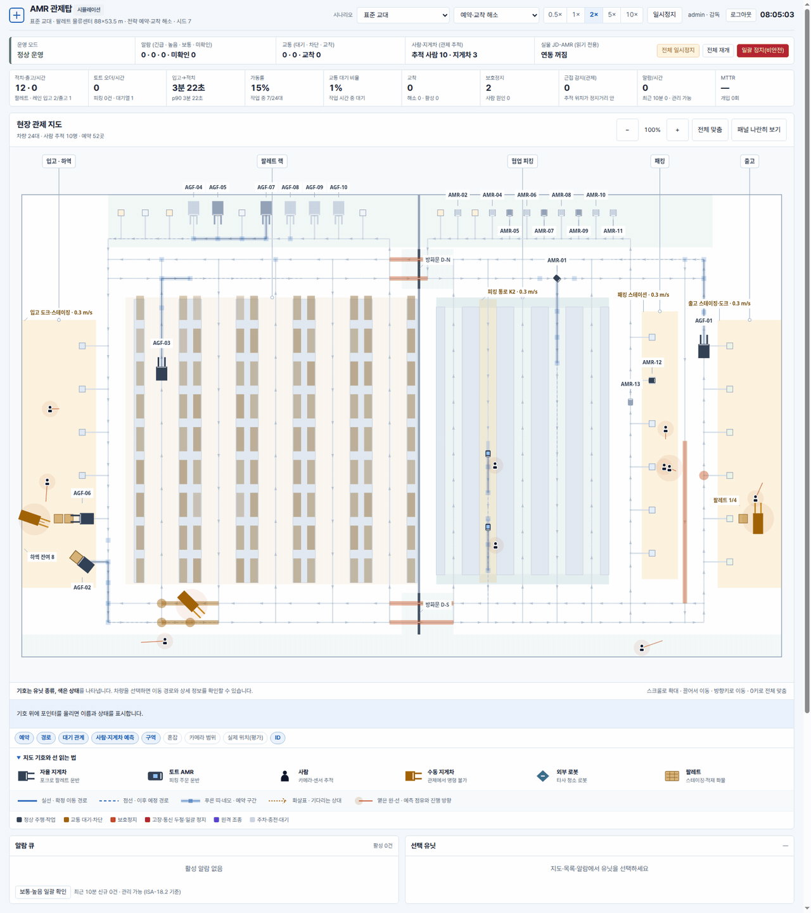
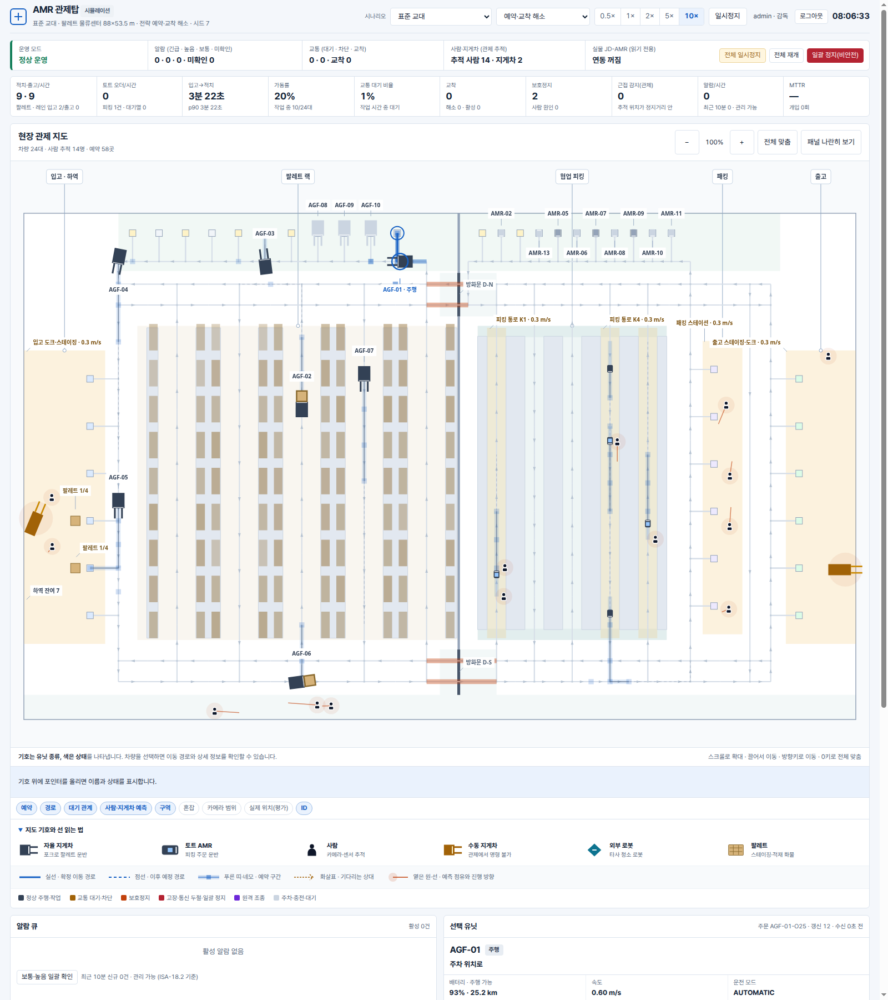
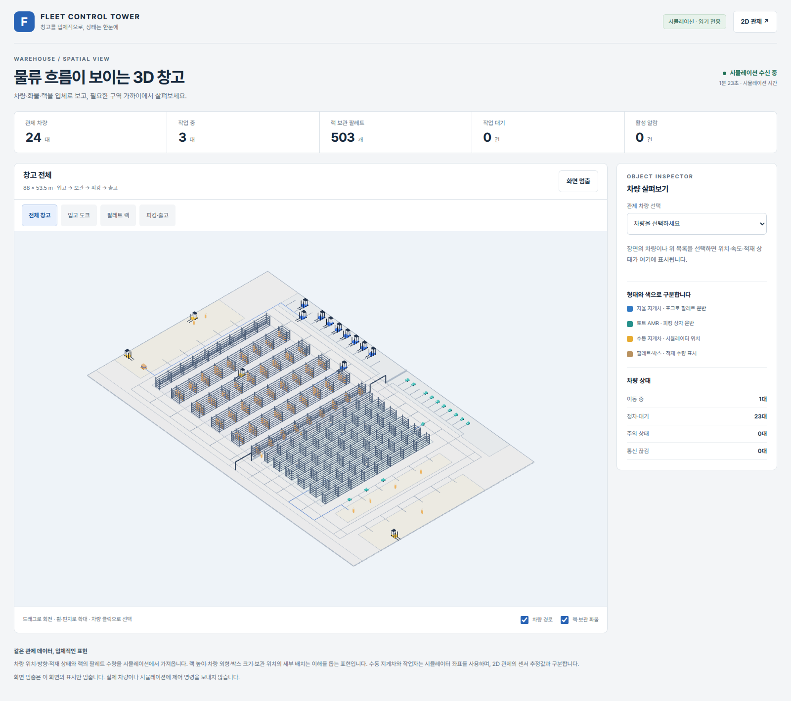
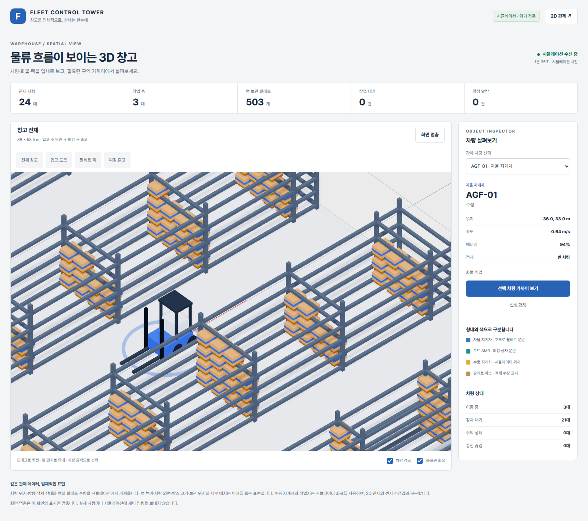

# Fleet Control Tower: 다중 AMR 관제 시스템

팔레트 물류센터의 자율 지게차(AGF)와 토트 AMR을 VDA 5050으로 운영하는 관제 시스템입니다. 같은 관제 코어를 설계 검증용 시뮬레이터와 MQTT 기반 실운영 서비스에서 사용합니다.

- **시뮬레이션 관제탑**(`fleet.server`): 수동 지게차, 피커, 보행자, 타사 청소 로봇, 천장 카메라가 있는 현장에서 교통 제어와 이상 대응 절차를 검증하고 차량 대수를 산정합니다.
- **실운영 관제 서비스**(`fleet.fms`): MQTT 브로커 건너편 차량을 VDMA LIF 레이아웃, SQLite 영속화, 재기동 재동기화, 계정과 권한, WMS 이벤트와 함께 운영합니다. 동봉한 차량 시뮬레이터(`fleet.agvsim`)와 mosquitto로 종단 시험을 마쳤으며 실차 상호운용 시험은 아직 하지 않았습니다.

관제는 안전 기능이 아닙니다. 사람 보호는 차량 탑재 안전 기능과 현장 설계가 맡고, 관제는 위험에 노출되는 상황을 줄이는 운영 계층입니다([docs/SAFETY.md](docs/SAFETY.md)).



<details>
<summary>정지 화면 보기</summary>



</details>

## 3D 창고 보기

기존 관제 데이터를 React와 React Three Fiber로 입체적으로 표시합니다. 2D 지도에서 **3D 보기**를 누르거나 `/3d/`로 이동합니다.



<details>
<summary>지게차 확대 화면 보기</summary>



</details>

- 자율 지게차·수동 지게차는 포크·마스트·바퀴·운전석을, 토트 AMR은 낮은 차체와 적재 상자를 구분해 표시합니다.
- 랙의 팔레트 수량, 입출고 스테이징 화물, 차량의 위치·방향·적재 여부를 기존 시뮬레이션에서 가져옵니다. 랙 높이·외형·화물 치수와 개별 보관 위치의 세부 배치는 설명용입니다.
- 전체 창고·입고·랙·피킹과 출고 카메라, 차량 선택과 근접 보기, 랙 숨기기, 화면 멈춤을 제공합니다. 화면 멈춤은 표시만 멈추며 제어 명령을 보내지 않습니다.
- 수동 지게차와 사람은 시뮬레이터 좌표로 표현합니다. 2D 관제의 센서 추정값과 구분하며, MQTT 실운영 화면에서는 이 시뮬레이션 전용 보기를 열지 않습니다.
- 3D 코드는 별도 경로에서 지연 로드합니다. 2D 화면에는 3D 라이브러리를 내려받지 않으며, 그래픽 지원 오류 때도 2D 관제를 사용할 수 있습니다.

3D 빌드에는 Node.js 22.12 이상이 필요합니다. Python 서비스에는 외부 Python 패키지가 필요하지 않습니다.

```bash
cd ~/fleet-control-tower
npm ci --prefix web3d
npm run build --prefix web3d
python3 -m fleet.server --scenario standard --speed 2 --no-jdamr
# 로그인 후 http://127.0.0.1:8095/3d/
```

Docker 이미지는 3D 빌드를 포함합니다. 로컬 Python 실행에서는 위 빌드를 먼저 수행하며, 생성물 `web/3d/`는 Git 추적에서 제외합니다.

## 현재 단계

| 단계 | 상태 | 근거와 남은 일 |
|---|---|---|
| 설계 검증용 시뮬레이터 | 갖춤 | 설계 기준 수요, 대수 산정, 워밍업 뒤 8시간 교대 실행, 여러 시드의 95% 신뢰구간, 가정 민감도, 공개 생산성 수치 대조를 [BENCHMARK](docs/BENCHMARK.md)에 기록. 수요와 행동 모델은 현장 데이터로 보정하지 않은 설계 추정치 |
| 파일럿 준비 | 일부 | MQTT 3.1.1 인증·TLS, VDA 5050 2.0.0 스키마 검사, 표준 폴백, LIF, 영속화와 재동기화, 계정과 감사, WMS 이벤트를 구현. 실차·벤더 시뮬레이터 상호운용 시험, 현장 위험성 평가, 카메라 피드와 문 PLC 어댑터는 남음 |
| 운영 | 해당 없음 | 이중화, 다중 관제석, 운영 관측 체계 없음 |

## 핵심 기능

| 영역 | 내용 |
|---|---|
| 현장 | 88 × 53.5 m 물류센터. 입고 도크 6개, 팔레트 랙 720슬롯, 방화벽 고속문 2개, 협업 피킹, 패킹, 출고 도크 6개. 일방통행 척추, 2차선 주통로, 동측 복귀로, 차종별 통행 제한([SITE.md](docs/SITE.md)) |
| 차량 | VDA 5050 2.0 클라이언트. factsheet로 차종과 지원 액션 선언, 속도 비례 보호·경고 필드, 좁은 필드 세트, 보호정지 자동 재개, 고장 래치, 안전 관련 고장의 원격 리셋 거부, 원격 조종 데드맨 |
| 교통 제어 | 노드·차선 예약, 교차로·문턱 통과 단위 예약, 회전 영역 예약, 교착 탐지와 재계획·비켜서기, 혼잡 회피 경로, 피킹 동 작업 방출 상한 |
| 통제 불가 유닛 | 카메라와 차량 센서 융합 추적, 사람·지게차 예측 점유, 주행 지게차 앞 선회 영역 선점, 통로 점유·요청 신호, 정지 지게차 선회 요청, 규칙 위반 모델 |
| 설비 | 방화벽 고속문 감독. 열림 보고 뒤 예약, 걸림·무응답·고장 판정과 우회, 화재 경보 연동 |
| 이상 상황 | ISA-18.2 알람 22종, 우선순위·보류·홍수·파생 억제, 알람별 자동 조치와 절차, 사고 전후 재생, 근접사고 알림 |
| 운영 | 확인 절차가 있는 명령, 일괄 정지 해제 뒤 자동 재개 금지, HMAC 체인 감사 로그, 교대 인계, SOP를 따르는 가상 운영자 |
| 연동 | MQTT 3.1.1, QoS 0·1, Last Will, 재접속, 인증·TLS, 메시지 스키마 검사, VDMA LIF, SQLite 영속화, 계정·역할·CSRF, 멱등 WMS 주문과 이벤트 outbox([INTEGRATION.md](docs/INTEGRATION.md)) |

## 채용 요구와의 대응

로봇 관제 채용 공고 53건(한국 33, 해외 20)에서 정리한 역량 순위([research/02 A-5](docs/research/02_jobs_and_incident_response.md))와 저장소의 근거를 연결했습니다.

| 순위 | 요구 역량 | 확인할 곳 |
|---|---|---|
| 1 | 이상 상황 처리 파이프라인(감지, 자동 대응, 확인·조치, 현장 대응, 재개, 기록·인계) | `fleet/alarms.py`, [RUNBOOK.md](docs/RUNBOOK.md), 화면 알람 대기열·사고 재생·교대 인계 |
| 2 | 교통 관리(충돌·교착 방지와 해소, 통제 불가 유닛) | `fleet/control.py`, [DESIGN.md §2–5](docs/DESIGN.md), 운영 방식 비교 벤치 |
| 3 | 작업 할당과 확장성 | `fleet/dispatcher.py`, `fleet/process_dc.py`, 대수 산정 벤치 |
| 4 | 실시간 관제 UI(식별·위치·속력·배터리·통신 감도·원격 정지) | `web/`, 차량 목록과 상세 화면 |
| 5 | 표준 메시징과 API | `fleet/vda5050.py`, `fleet/schema.py`, `fleet/mqtt.py`, `fleet/server.py` |
| 6 | 상위 시스템·설비 연동과 실패 주입 | WMS API, `fleet/facility.py`, 문 고장 훈련 |
| 7 | 데이터와 KPI | 화면 KPI와 추세, `fleet/bench.py`, 결과 JSON |
| 8 | 결함 주입 기반 검증 | 훈련 명령, Python 346개·Node 19개 시험, [BENCHMARK.md](docs/BENCHMARK.md) |
| 9 | 배포와 운영성 | `Dockerfile`, 인증·권한, 헬스체크, 읽기 전용 모드 |
| 10 | 사고 조사와 문서화 | 사고 재생, 보고서·인계 양식, 비상 계획표([RUNBOOK.md](docs/RUNBOOK.md)) |

## 실행

Python 3.11 이상이 필요하며 외부 Python 패키지는 쓰지 않습니다.

```bash
cd ~/fleet-control-tower
python3 -m fleet.server --scenario standard --speed 5
# 첫 실행에 감독자 계정 admin의 비밀번호를 한 번 출력합니다.
# 브라우저: http://127.0.0.1:8095
```

로그인 없이 화면만 확인할 때는 개발용 `--no-auth`를 씁니다. 루프백 주소에서만 허용됩니다. MQTT 브로커에 실운영 서비스와 차량 시뮬레이터를 연결하는 방법은 [docs/INTEGRATION.md](docs/INTEGRATION.md)에 있습니다.

지도는 **넓게 보기**가 기본이며, 보조 패널은 지도 아래에 표시합니다. 넓은 화면에서 **패널 나란히 보기**를 누르면 보조 패널을 지도 옆으로 옮길 수 있습니다. 확대·축소와 전체 맞춤도 지원합니다. 차량 종류는 그림 기호, 상태는 색, 이동 경로·예약·대기 관계는 선으로 구분합니다. 수동 지게차는 고정된 그림 기호로 종류·위치를 표시합니다. 차체 방위는 측정하지 않으며, 이동 방향이 확인됐을 때만 추정 방향선을 표시합니다. 정지로 판정되면 방향선을 생략하며, 순간 속도 잡음으로 기호를 회전시키지 않습니다. 구역 이름은 지도 위쪽 연결선으로 표시하고, 유닛 이름과 연결선은 다른 기호·랙·글자를 피할 자리가 있을 때 표시합니다. 지도 아래의 **지도 기호와 선 읽는 법**에서 뜻을 확인할 수 있습니다.

```bash
cd ~/fleet-control-tower
docker build -t fleet-control-tower .
docker run --rm -p 127.0.0.1:8095:8095 -v fct-data:/data fleet-control-tower
docker logs <컨테이너>          # 첫 실행의 admin 비밀번호 확인
```

| 옵션 | 기본값 | 설명 |
|---|---|---|
| `--scenario` | `standard` | 아래 시나리오 중 하나 |
| `--strategy` | `locks+resolve` | `none`(관제 없음), `locks`(예약·일반 우회), `locks+resolve` |
| `--speed` | `1` | 0.5·1·2·5·10배속. 원격 조종 중에는 1배속 이하 |
| `--seed` | `7` | 난수 시드. 같은 코드와 실행 환경에서 비교 조건을 재현할 때 사용 |
| `--auto-operator` | 꺼짐 | 가상 운영자가 SOP에 따라 알람을 확인하고 조치 |
| `--read-only` | 꺼짐 | 관찰 전용. 모든 명령을 거부하고 시도는 감사 로그에 기록 |
| `--db` | `~/.local/state/fleet-control-tower/server.sqlite3` | 계정·세션·감사 로그·멱등 키 저장소 |
| `--add-user NAME:ROLE`, `--create-api-key NAME` | 없음 | 계정(viewer·operator·supervisor)이나 WMS API 키를 만들고 종료 |
| `--no-auth`, `--secure-cookie` | 꺼짐 | 개발용 인증 끄기, TLS 프록시 뒤 Secure 쿠키 사용 |
| `--port`, `--host` | `8095`, `127.0.0.1` | HTTP 수신 주소 |
| `--no-jdamr`, `--jdamr-url` | 루프백 8090 | 실물 JD-AMR 상태 읽기 사용 여부와 주소 |

## 시나리오

| 이름 | 용도 | 기본 구성 |
|---|---|---|
| `standard` | 표준 교대 | AGF 10대, 토트 AMR 14대, 피커 7명, 설계 평균 수요 |
| `peak` | 피크 시간 | AGF 11대, 토트 AMR 16대, 피커 8명, 설계 피크 수요(입고 트럭 3대·출고 39팔레트·토트 103건/h) |
| `crowded` | 사람 밀집 시험 | 피커 12명, 도크 작업자 6명, 보행자 6명, 타사 청소 로봇 1대 |
| `faults` | 장애 대응 훈련 | 로봇별 고장·통신 두절 평균 1시간, 메시지 손실 2%, 고속문 고장 |
| `night` | 야간 입출고 | 피킹 없음, 최소 인원, 청소 로봇, 입고 트럭 2.5대·출고 15팔레트/h |
| `grid` | 혼합 교통 알고리즘 시험 | 단일 차종 AMR 30대, 사람 8명, 지게차 2대 |
| `grid-night` | 교통 코어 기준선 | 사람·수동 지게차 없는 격자, AMR 20대·청소 로봇 1대 |
| `grid-deadlock` | 교착 스트레스 | 1차선 양방향 격자, AMR 36대, 240건/h |

## 결과 요약

같은 커밋의 148회 실험으로 대수·운영 방식·가정의 영향을 비교했습니다. 동일 조건 재현 대조 5쌍은 전체 KPI가 일치했습니다. 일부 조건에는 큰 출고 정체와 접촉이 남아, 현재 결과는 설계 대안 비교와 병목 탐색의 근거로 사용합니다.

| 확인 항목 | 결과 |
|---|---|
| 설계 피크 대수 산정 | 28회 실행. 기본 규칙의 토트 AMR 14·16대는 평균 100건/h로 같고 목표 103건/h에 못 미침. AGF 11대 한 시드의 큰 정체와 일부 접촉이 남아 확정 대수는 보류 |
| 표준 8시간 교대 | 4시드의 출고 3~31.5·토트 76.8~85.5건/h. 두 시드에 방출 전 출고 주문 217·170건이 남음 |
| 피크 8시간 교대 | 3시드의 토트 50.5~104.9건/h, 평균 85.4로 목표 103 미달. 종료 대기 작업 253·44·25건 |
| 안전·알람 지표 | 교대 15회 모두 점유·예약 불일치와 예약 자료 검사 문제 0. 그러나 실행당 이동 중 접촉 0~5건·피충돌 접촉 0~213건, 알람 1~128.1건/h가 남음 |
| 결과 커밋과 실행 수 | `07ac6b5`의 결과 JSON 8개·총 148회. 실행 행렬·워밍업·측정 시간·동일 조건 5쌍 대조 통과 |

자세한 방법, 95% 신뢰구간, 시나리오별 편차와 설계 피크 토트 목표의 미달 여부는 [docs/BENCHMARK.md](docs/BENCHMARK.md)에 기록합니다.

## 구조

```text
fleet/
  site_dc.py      물류센터 레이아웃              layout.py      그래프·구역·검증
  vda5050.py      VDA 5050 메시지                schema.py      공식 JSON 스키마 검증
  bus.py          프로세스 내 버스               mqtt.py        MQTT 3.1.1 클라이언트
  vehicle.py      차량·안전 필드·고장            control.py     예약·교착·우회·인지
  traffic.py      잠금·순환 탐지                 planner.py     시간 기반 A*
  perception.py   추적·예측 점유                 facility.py    고속문 장치와 감독
  alarms.py       알람과 SOP                     dispatcher.py  작업 배정·충전·WMS
  process_dc.py   물류센터 공정                  agents*.py     사람·지게차·타사 로봇
  ops.py          운영 명령·감사·인계            sim.py         시뮬레이션·평가기
  server.py       시뮬레이션 HTTP·SSE            fms.py         실운영 서비스
  agvsim.py       MQTT 차량·문 시뮬레이터        auth.py        계정·세션·CSRF·API 키
  store.py        SQLite·감사 체인               bench.py       벤치마크
web/              2D 관제 화면·3D 빌드 산출물
web3d/            React·React Three Fiber 3D 시뮬레이션 뷰
sites/            물류센터·격자 LIF와 사이드카
tools/            재현·상호운용·화면 점검 도구
tests/            단위·시스템·HTTP·MQTT·런타임 시험
docs/             설계·현장·안전·연동·운영·벤치마크 문서
results/          벤치마크 결과 JSON
```

## HTTP API

| 메서드·경로 | 권한 | 설명 |
|---|---|---|
| `POST /api/login`, `/api/logout`, `GET /api/me` | 공개·세션 | 로그인, 로그아웃, 현재 사용자와 CSRF 토큰 |
| `GET /api/stream` | viewer | 차량·알람·예약·추적·문·KPI의 SSE 스냅숏 |
| `GET /api/snapshot`, `/api/layout`, `/api/meta`, `/api/history` | viewer | 현재 상태, 레이아웃, 메타, 추세 |
| `POST /api/command` | operator, 일부 supervisor | 확인과 CSRF 검사가 있는 운영 명령 |
| `POST /api/wms/orders`, `GET /api/wms/events?after=N` | WMS API 키 | 멱등 주문과 작업 이벤트 커서 조회 |
| `GET /api/audit`, `/api/audit/verify`, `/api/handover` | viewer | 감사 로그·체인 검증·교대 인계 |
| `GET /api/incident/{id}`, `/api/vda5050/{serial}`, `/api/local/{serial}` | viewer | 사고 재생, VDA 5050 메시지, 원격 조종용 보기 |
| `POST /api/control` | supervisor | 배속·일시정지·재시작·가상 운영자 제어 |
| `GET /health` | 공개 | 헬스체크 |

## 검증

```bash
cd ~/fleet-control-tower
python3 -m unittest discover -s tests -t .  # Python 346개(doctest 포함)
node --test tests/test_logic.cjs             # 화면 계산 함수 19개
WORKERS=4 bash tools/benchmarks.sh shift     # 8시간 교대 시나리오
```

- 현재 코드로 Python 346개, Node 19개 시험 통과를 확인했습니다. 화면 시험에는 센서 잡음이 있는 지게차의 정지·이동 구분, 최소 배율의 기호 선택, 혼잡한 지도의 라벨·연결선 겹침 회피를 포함합니다.
- 벤치 결과 JSON에는 설정과 Python 버전, git 커밋을 기록합니다. 추적 파일이 바뀐 상태면 커밋 뒤에 `+dirty`가 붙습니다.
- 실운영 경로는 `tools/mqtt_interop_check.py`와 Docker 종단 시험으로 검사합니다. `2370edf`에서 익명 브로커 환경의 MQTT 검사 9/9, WMS 주문 완료·고속문 열림·감사 로그 검사 통과를 확인했습니다. 인증·TLS 환경 각 9/9는 앞선 검증 이력이며 그 이후 소스에서는 재시험하지 않았습니다.
- `tools/ui_check.mjs`는 헤드리스 Chrome으로 로그인·KPI·CSRF·로그아웃과 지도 확대·이동·넓게 보기·차량 선택·레이어·범례를 확인합니다. 데스크톱, 태블릿, 모바일과 데스크톱 200% 확대에 해당하는 절반 CSS 뷰포트에서 잘림과 라벨·연결선 겹침도 검사합니다.

## 문서

| 문서 | 내용 |
|---|---|
| [docs/DESIGN.md](docs/DESIGN.md) | 구성, 충돌 관리, 교통 제어, VDA 5050 매핑, 통제 불가 유닛, 설비와 알람 |
| [docs/SITE.md](docs/SITE.md) | 현장 배치, 차량·현장 치수, 인지·행동 모델, 설계 기준 수요 |
| [docs/SAFETY.md](docs/SAFETY.md) | 관제의 안전상 위치, 구역 분류, 위험성 평가, 안전 지표 |
| [docs/INTEGRATION.md](docs/INTEGRATION.md) | MQTT·VDA 5050·LIF·WMS·인증·재기동 복구 |
| [docs/RUNBOOK.md](docs/RUNBOOK.md) | 교대 흐름, 알람 대응, 비상 계획, 재기동, 보고서와 인계 |
| [docs/BENCHMARK.md](docs/BENCHMARK.md) | 방법, 대수 산정, 교대 결과, 운영 방식, 민감도, 결함 기록 |
| [docs/research/](docs/research/) | 표준·교통 제어·안전, 채용 공고, 현장·차량 제원 조사 원문 |

## 한계

- 현장과 행동은 시뮬레이션입니다. 실차 상호운용과 현장 위험성 평가는 하지 않았습니다.
- 사람·수동 지게차 행동, 고장률, 통신 두절률, 카메라 오차와 수요는 가정입니다. 현장 WMS 이력과 실측 사이클로 다시 보정해야 합니다.
- 관제가 추정하는 사람 궤적은 움직임이 시작된 뒤 관측 이력이 쌓이기 전까지 정지로 볼 수 있습니다. 차량 탑재 안전 기능이 사람 보호를 맡아야 합니다.
- AGF의 원호 선회는 제자리 회전 시간과 회전 영역 예약으로 근사합니다.
- 이중화, 다중 관제석, 장기 보존 관측 체계, 엘리베이터 연동, VDA 5050 3.0 zone·map 배포는 구현하지 않았습니다.
- 장시간 출고 정체, 피크 토트 목표 미달, 이동 중·피충돌 접촉이 남았습니다. 소수 시드의 평균만으로 확정 대수·현장 용량·안전을 보증할 수 없습니다.
